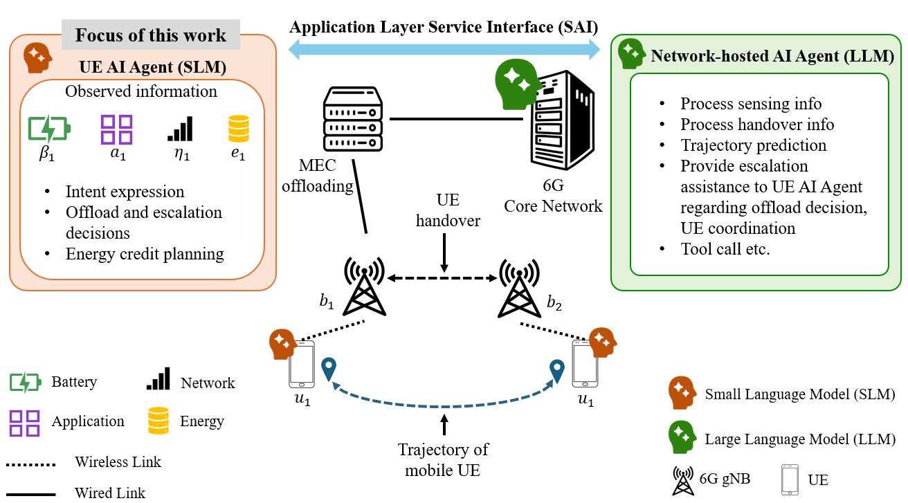

# SLM-ACE: Agentic Compute Offloading and Escalation at the UE in 6G Networks

**SLM-ACE** (Small Language Model for Agentic Compute and Escalation) is a lightweight framework for autonomous offloading and network-LLM escalation decisions in 6G networks. It fine-tunes [SmolLM2-135M](https://huggingface.co/HuggingFaceTB/SmolLM2-135M) using supervised instruction tuning (SFT) followed by Group Relative Policy Optimisation (GRPO) via HuggingFace TRL and PEFT (LoRA), running fully on CPU.

---

## Overview



Modern UE applications span a wide range of compute intensities — from background podcasts to AR/VR workloads — while operating under dynamic battery, network, and energy credit constraints. SLM-ACE frames the **joint offloading and escalation** problem as a constrained utility maximisation task and trains a sub-200M parameter language model to produce structured JSON decisions grounded in natural-language system context, without access to explicit state vectors.

The reward function jointly optimises:

```
U(o, e | s)  =   R  +   V  −   C  −   P  −  Φ
```

| Term      | Meaning                                                                            |
|-----------|------------------------------------------------------------------------------------|
| `R(o, s)` | Offload utility: net compute saving from task offloading                           |
| `V(e, s)` | Escalation value: expected gain from delegating to a network LLM                   |
| `C(e, s)` | Escalation cost: cost of one round trip escalation in terms of latency             |
| `P(o, s)` | Constraint penalty: hard feasibility violations (C1: low battery; C8: weak signal) |
| `Φ(o, y)` | Credit-floor penalty: penalty for offloading below the floor y_min = 0.10          |

An **escalation credit threshold** y_esc = 0.20 defines a scarcity zone (y_min, y_esc] where escalation uncertainty is raised and escalation value is discounted, acting as a soft reward modulator instead of a hard constraint.

---

## Repository Structure

```
edge-cloud-agentic-collab/
├── data/
    └── generate_dataset.py       # Synthetic dataset generation from mobility traces
├── models/                       # not committed
├── scripts/
    └── reward_model.py           # Reward model used during GRPO training
    └── run_sft.py                # Stage 1: Supervised fine-tuning (SFT)
    └── run_grpo.py               # Stage 2: GRPO reinforcement fine-tuning
    └── evaluate.py               # Core evaluation harness and metric families
    └── evaluate_baselines.py     # Seven-policy baseline comparison + figure generation
    └── evaluate_robustness.py    # OOD and mobility robustness evaluation
    └── plot_robustness.py        # Robustness figure generation
    └── plot_rewards.py           # Training curve plots
    └── monitor_grpo.py           # Live training monitor
```

---

## Metric Families

| Family | Metric | Description |
|--------|--------|-------------|
| **MNU** | U(o,e\|s) | Mean net utility over all decisions |
| **COR** | Offload quality | Mean offload utility over the feasible region |
| **VER** | Escalation quality | Rate of well-timed, high-value escalations |
| **FVR** | Feasibility violation rate  | Fraction of decisions violating hard constraints |
| **Credit/step** | Credit efficiency | Mean energy credit consumed per decision step |

> **Note:** COR, VER, and credit/step are defined only over the feasible region. Policies that never produce feasible decisions (always-offload, always-escalate) report N/A for these metrics.

---

## Policies Evaluated

| Policy | Description                                                |
|--------|------------------------------------------------------------|
| `random` | Uniform random valid (o, e): lower bound                   |
| `always_offload` | Unconditional offload: stress-tests constraint penalties   |
| `always_escalate` | Unconditional escalation: symmetric stress-test            |
| `few_shot` | Untuned SmolLM2-135M with k=3 in-context examples          |
| `sft` | SFT-only model: stage 1 baseline                           |
| `slm_ace` | GRPO checkpoint (step 800): **primary result**             |
| `exhaustive` | Deterministic ground-truth policy: theoretical upper bound |

---


SLM-ACE achieves the highest MNU among all learnable policies (2.7× over SFT-only), reduces the feasibility violation rate to 7.7%, and matches near-exhaustive credit efficiency, from a 135M-parameter model running on CPU.

SLM-ACE also surpasses the exhaustive baseline on MNU (+0.211 vs. +0.155). This is explained by the training distribution: the synthetic dataset over-represents high-utility scenarios relative to the uniform evaluation distribution, which inflates the learned policy's expected utility without requiring it to generalise beyond the training manifold. The effect is reflected in COR (82.2% vs. 100%) and VER (47.4% vs. 100%), where the exhaustive baseline outperforms.

---

## Installation

```bash
git clone git@github.com:tini-creator/edge-cloud-agentic-collab.git
```

**Core dependencies:** `transformers`, `trl`, `peft`, `datasets`, `torch` (CPU), `matplotlib`, `numpy`, `pandas`

---

## Usage

### 1. Generate the dataset

```bash
python generate_dataset.py
```

Reads `data/radio_parameters_moving_clean.csv` (mobility traces) and writes a Hugging Face `Dataset` to `data/`.

### 2. Run SFT

```bash
python run_sft.py
```

Fine-tunes SmolLM2-135M on instruction-formatted examples. Checkpoint saved to `models/sft-ue-merged/`.

### 3. Run GRPO

```bash
python run_grpo.py --checkpoint models/sft-ue-merged
```

Runs GRPO reinforcement fine-tuning from the SFT checkpoint. Best checkpoint saved to `models/grpo-ue-agent/`.

### 4. Monitor training

```bash
python monitor_grpo.py --metrics models/grpo_metrics.json
```

Prints a live reward curve and per-component breakdown as training progresses.

### 5. Plot training curve

```bash
python plot_rewards.py --paper --metrics models/grpo_metrics.json --out fig_rewards.svg

# Interactive dashboard
python plot_rewards.py --metrics models/grpo_metrics.json
```

### 6. Evaluate

```bash
# Full baseline comparison (runs inference, saves results, generates figures)
python evaluate_baselines.py --grpo-checkpoint models/grpo-ue-agent/checkpoint-800

# Re-plot from saved results without re-running inference
python evaluate_baselines.py --skip-eval --fmt svg

# Robustness evaluation across mobility and load axes
python evaluate_robustness.py
python plot_robustness.py
```

Figures are written to the directory specified by `--out` (default: current directory). The baseline script produces two paper-quality SVG figures:

- `fig_mnu_cor_ver.svg` — MNU, COR, and VER side by side
- `fig_credit_fvr.svg` — Credit/step, R(o,s), and FVR side by side

---

## Citation

If you use this code or the SLM-ACE framework in your work, please cite:

```bibtex
@inproceedings{majumdar2026slmace,
  title     = {{SLM-ACE}: Agentic Compute Offloading and Escalation at the {UE} Edge},
  author    = {Majumdar, Sayantini and others},
  booktitle = {Proceedings of ...},
  year      = {2026},
}
```

---

## License

This project is released under the MIT License. See `LICENSE` for details.